# Site de Receitas

Projeto Final - RA 3. Site de receitas que busca dados reais da API pública TheMealDB, tem um formulário que envia dados por POST e fica publicado no GitHub Pages.

**Tema:** receitas
**Site publicado:** (colocar aqui o link do GitHub Pages)

## Integrantes e o que cada um fez

| Integrante | O que fez |
|---|---|
| Giovana Resnauer | API e página Receitas: busca, cartões e favoritos |
| Nathaly Abreu | Página Ferramentas: calculadora de porções e estatísticas (TDE 01) |
| Gabriel Men | Estrutura e visual: página inicial, HTML semântico, CSS compartilhado, modo escuro com localStorage, página de contato e POST no JSONPlaceholder |

## Páginas e arquivos

| Página | HTML | JavaScript |
|---|---|---|
| Início | `index.html` | `JS/escuro.js` |
| Receitas | `receitas.html` | `JS/receitas.js`, `JS/escuro.js` |
| Ferramentas | `ferramentas.html` | `JS/ferramentas.js`, `JS/escuro.js` |
| Contato | `contato.html` | `JS/contato.js`, `JS/escuro.js` |

Todas as páginas usam o mesmo `style.css`. O `JS/escuro.js` cuida do modo escuro.

## API usada

| Uso | Método | Endereço |
|---|---|---|
| Buscar receitas | GET | `https://www.themealdb.com/api/json/v1/1/search.php?s=chicken` |
| Enviar o formulário de contato | POST | `https://jsonplaceholder.typicode.com/posts` |

O POST envia um JSON com `title` (assunto), `body` (mensagem), `userId`, `nome`, `email`, `telefone` e `pessoas`. O JSONPlaceholder finge que salva e devolve o status **201**, que aparece na tela como confirmação.

## localStorage

| Chave | O que guarda |
|---|---|
| `favoritos` | Receitas favoritas |
| `receitasAPI` | Última lista de receitas buscada (usada na página Ferramentas) |
| `modoEscuro` | `true` ou `false` |

## TDE 01

Ferramenta da página **Ferramentas** (`ferramentas.html` + `JS/ferramentas.js`): uma calculadora que ajusta os ingredientes de uma receita para o número de porções desejado, e estatísticas das receitas favoritas.

### Funções

| Função | Recebe | Devolve | Onde é usada |
|---|---|---|---|
| `somar(a, b)` | dois números | `a + b` | `interpretarMedida` (soma as partes de "1 1/2") e `mediaIngredientes` (soma o total) |
| `subtrair(a, b)` | dois números | `a - b` | `calcular` (diferença entre a quantidade nova e a original) |
| `multiplicar(a, b)` | dois números | `a * b` | passada como callback para `calcularOperacao` dentro de `calcular` (quantidade × fator) |
| `dividir(a, b)` | dois números | `a / b`; se `b` for 0, mostra a mensagem "Não é possível dividir por zero." na tela (no lugar de `Infinity`) e devolve 0 | `calcularOperacao` (como callback), `interpretarMedida` (frações) e `mediaIngredientes` |
| `calcularOperacao(a, b, operacao)` | dois números e **uma função** (`somar`, `subtrair`, `multiplicar` ou `dividir`) | o resultado de `operacao(a, b)` | `calcular`: `calcularOperacao(desejada, original, dividir)` (fator) e `calcularOperacao(medida.quantidade, fator, multiplicar)` (nova quantidade) |
| `formatar(numero)` | um número | texto com até 2 casas decimais e vírgula (`1,5`) | `calcular` e `calcularEstatisticas` |
| `organizarIngredientes(receita)` | uma receita da API | array de objetos `{ nome, quantidade }` | `calcular` e `mediaIngredientes` |
| `interpretarMedida(medida)` | texto da medida (`"2"`, `"1/2"`, `"1 1/2 cup"`) | `{ quantidade, unidade }` ou `null` se não começar com número | `calcular` |
| `carregarReceitas()` | nada | nada (preenche o `select` com as receitas da API e os favoritos, sem repetir) | início da página e ao remover um favorito |
| `obterReceitaSelecionada()` | nada | a receita escolhida no `select` (`find`) ou `undefined` | `calcular` |
| `calcular()` | nada (lê os campos da tela) | nada (valida, calcula o fator e mostra os ingredientes) | evento `click` do botão "Calcular ingredientes" |
| `mediaIngredientes(lista)` | array de receitas | média de ingredientes por receita (0 se a lista estiver vazia) | `calcularEstatisticas` |
| `filtrarPorIngredientes(lista, minimo)` | array de receitas e um número mínimo de ingredientes | novo array só com as receitas que têm pelo menos `minimo` ingredientes (`filter`) | `calcularEstatisticas` ("Favoritas com 8 ou mais ingredientes") |
| `calcularEstatisticas()` | nada | nada (mostra a quantidade de favoritas e as médias) | início da página e ao remover um favorito |
| `mostrarReceitas()` | nada | nada (lista os favoritos, cada um com botão "Remover") | início da página e ao remover um favorito |

### Onde cada requisito aparece

- **As 4 operações:** `somar`, `subtrair`, `multiplicar` e `dividir`, usadas dentro de `calcular`, `interpretarMedida` e `mediaIngredientes`. A divisão por zero mostra uma mensagem na tela.
- **Funções que manipulam array:** `mediaIngredientes(lista)` calcula a média de ingredientes de uma lista de receitas (favoritas ou todas as da API) e `filtrarPorIngredientes(lista, minimo)` filtra as receitas por uma condição.
- **Callback:** `calcularOperacao(a, b, operacao)` recebe outra função como parâmetro. Exemplo do projeto: `calcularOperacao(desejada, original, dividir)`.
- **Arrow functions:** `parte => { ... }` no `forEach` de `interpretarMedida`, `r => [r.idMeal, r]` no `map` e `receita => receita.idMeal === receitaSelect.value` no `find` de `obterReceitaSelecionada` e `receita => organizarIngredientes(receita).length >= minimo` no `filter` de `filtrarPorIngredientes`.
- **Funções anônimas:** os `function() { ... }` dos `addEventListener` (clique na lista de favoritos e evento `change` do `select`).
- **Métodos de array usados no projeto:** `forEach`, `map`, `filter`, `find`, `includes` e `push`.

## TDE 02

Relatório dos erros reais que apareceram durante o projeto.

### Erro 1 — CSS da página inicial não carregava (aba Network, 404)

- **Sintoma:** a página inicial (`index.html`) abria sem nenhum estilo (texto preto em fundo branco), enquanto as outras páginas estavam normais.
- **Como foi identificado:** na aba **Network** do DevTools (F12), a requisição do `style.css` aparece em vermelho com status **404**. A coluna **Initiator** aponta para `index.html:7`, ou seja, a linha 7 do `index.html` pede um arquivo que não existe. Comparando com as outras páginas, só o `index.html` apontava para esse caminho.

  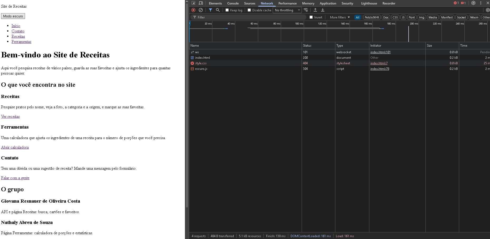
- **Causa:** depois que o `style.css` saiu da pasta `CSS/` e foi para a raiz do projeto (por causa do GitHub Pages), o `index.html` continuou apontando para o caminho antigo. O `/` no começo ainda faz o navegador procurar a partir da raiz do site, em uma pasta `CSS` que não existe mais.
- **Antes** (linha 7 do `index.html`):
  ```html
  <link rel="stylesheet" href="/CSS/style.css">
  ```

  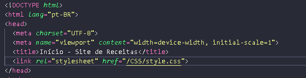

- **Depois:**
  ```html
  <link rel="stylesheet" href="style.css">
  ```

  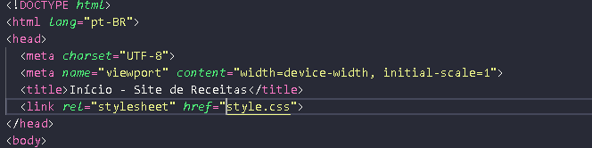

- **Resultado:** com o caminho certo, o `style.css` passou a carregar (status **304**, que significa que o navegador reaproveitou o arquivo que já tinha) e a página inicial apareceu com o estilo.

  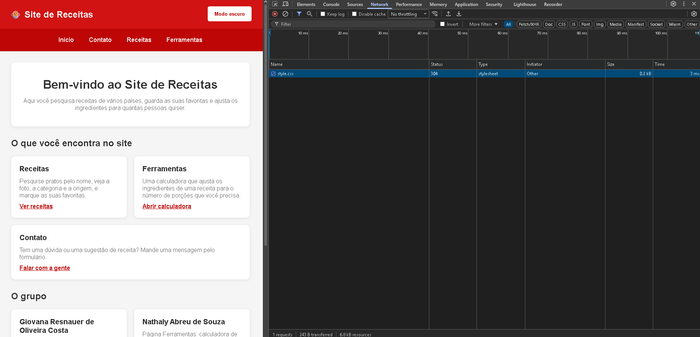

### Erro 2, de lógica — Ferramentas não via as receitas buscadas (média "todas" sempre 0)

- **Sintoma:** o código rodava sem nenhum erro vermelho, mas na página **Ferramentas** o campo "Média de ingredientes (todas)" aparecia sempre como `0`, e o `select` de receitas só mostrava as favoritas, nunca as receitas buscadas na página Receitas.
- **Como foi identificado:** na aba **Application › Local Storage** do DevTools, a chave `receitasAPI` não existia depois de buscar receitas (só `favoritos`). Como a página Ferramentas lê essa chave, a lista chegava vazia e a média dava 0. A busca no `JS/receitas.js` guardava as receitas só na variável `receitas`, mas não salvava no `localStorage`.
- **Antes** (`JS/receitas.js`):
  ```js
  const dados = await resposta.json();

  receitas = dados.meals || [];
  ```

  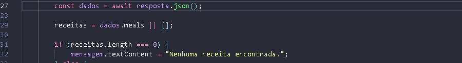

- **Depois:**
  ```js
  const dados = await resposta.json();

  receitas = dados.meals || [];

  // Salva as receitas encontradas para a página Ferramentas usar
  localStorage.setItem("receitasAPI", JSON.stringify(receitas));
  ```

  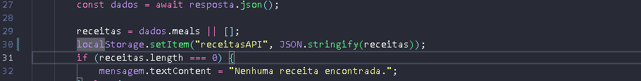

- **Resultado:** depois da correção, a chave `receitasAPI` passou a aparecer no Local Storage e a "Média de ingredientes (todas)" na página Ferramentas passou de `0` para `12,36`.
- **Prints (antes):**

  Local Storage sem a chave `receitasAPI`, mesmo com a página Receitas carregada:

  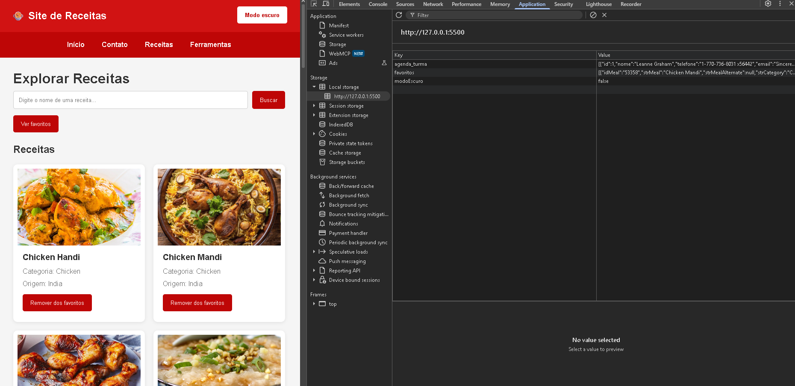

  Página Ferramentas com a média de todas as receitas em `0`:

  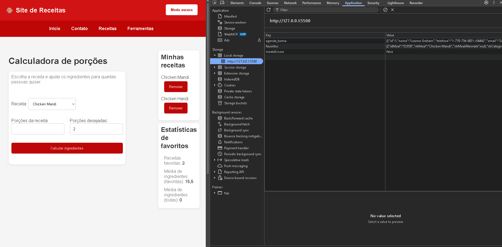

- **Print (depois):** Local Storage com a chave `receitasAPI` e a média de todas as receitas em `12,36`:

  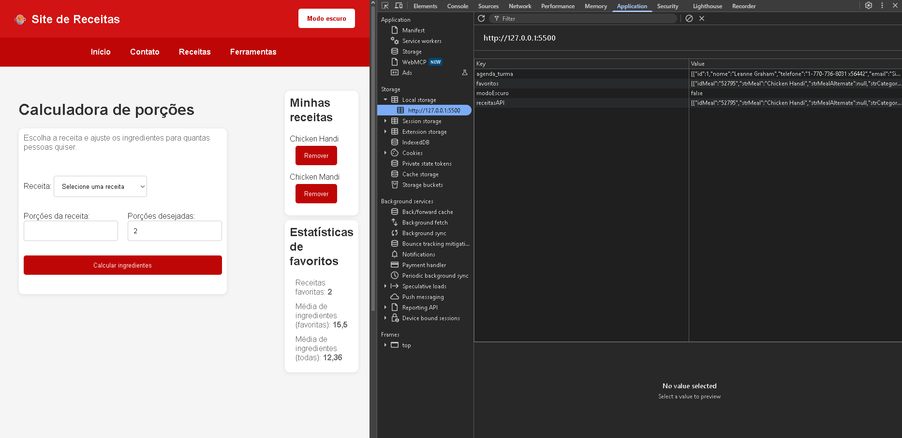

### Erro 3 — `Cannot read properties of null` na página Ferramentas (Console e Sources)

- **Sintoma:** a página Ferramentas abria vazia: o `select` de receitas, a lista de favoritos e as estatísticas não apareciam, e o botão "Calcular ingredientes" não fazia nada. No **Console** apareceu o erro em vermelho:
  `Uncaught TypeError: Cannot read properties of null (reading 'addEventListener')` em `ferramentas.js:234`.

  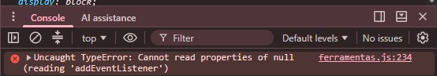

- **Como foi identificado:**
  1. O Console mostra o arquivo e a linha (`ferramentas.js:234`). Clicando no link, a aba **Sources** abre o arquivo e marca a linha 234 com o ❌: `botaoCalcular.addEventListener("click", calcular);`.

     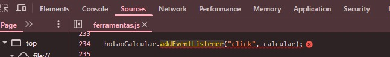

  2. A mensagem diz que `botaoCalcular` é `null`, ou seja, o `getElementById` não achou o elemento. Procurando onde essa variável é criada (linha 7), o id estava escrito `"calcula"`, e no HTML o botão é `<button id="calcular">`.

     

- **Por que a página inteira parou:** o erro acontece na linha 234 e interrompe o script. Por isso as últimas linhas do arquivo (`carregarReceitas()`, `mostrarReceitas()` e `calcularEstatisticas()`) nunca rodavam.
- **Antes:**
  ```js
  const botaoCalcular = document.getElementById("calcula");
  ```
- **Depois:**
  ```js
  const botaoCalcular = document.getElementById("calcular");
  ```
- **Resultado:** depois de corrigir o id, o Console ficou sem erros e a página carregou normalmente.

  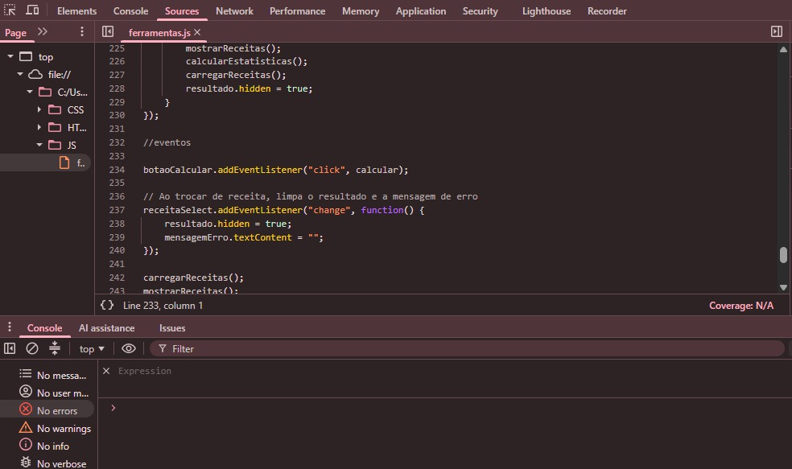

### Erro 4, de lógica — divisão por zero devolvia 0 sem avisar

- **Sintoma:** no Console, `dividir(10, 0)` devolvia `0` e nada aparecia na tela. O resultado parecia válido, mas estava errado, e a pessoa não sabia que houve uma divisão por zero.
- **Como foi identificado:** com um **breakpoint** na linha `if (b === 0)` (DevTools › Sources › `ferramentas.js`), dá para acompanhar o valor de `a` e `b` no painel **Scope** a cada chamada da função (print abaixo). Lendo o `if`, vê-se que, quando `b` é `0`, o código devolvia `0` em silêncio, sem nenhum aviso para a pessoa.
- **Antes:**
  ```js
  function dividir(a, b) {
      if (b === 0) {
          return 0;
      }
      return a / b;
  }
  ```
- **Depois:**
  ```js
  function dividir(a, b) {
      if (b === 0) {
          // Divisão por zero: mostra uma mensagem na tela em vez de devolver Infinity
          mensagemErro.textContent = "Não é possível dividir por zero.";
          return 0;
      }
      return a / b;
  }
  ```
  Também foi preciso proteger a média de uma lista vazia (`if (lista.length === 0) return 0;` em `mediaIngredientes`), para o aviso não aparecer ao abrir a página sem favoritos.

### Print do código pausado em um breakpoint

Breakpoint colocado na linha 35 de `JS/ferramentas.js` (`if (b === 0)`, dentro de `dividir`). Com "Porções da receita" = 4 e "Porções desejadas" = 2, ao clicar em "Calcular ingredientes" o código pausa nessa linha. O painel **Scope** mostra `a: 2` e `b: 4` (o fator é porções desejadas ÷ porções originais), e o **Call Stack** mostra que `dividir` foi chamada por `calcular`. Se `b` fosse `0`, a execução entraria no `if` e cairia no `return 0`, que era o comportamento errado do Erro 4.

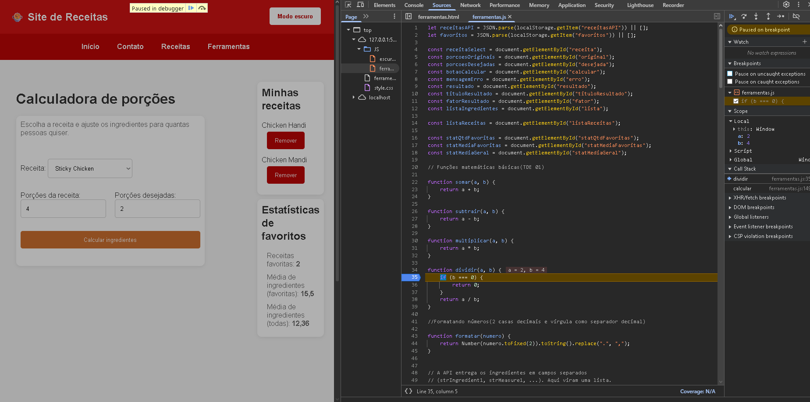
